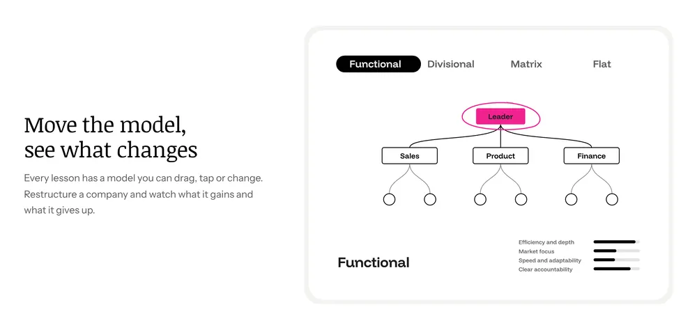
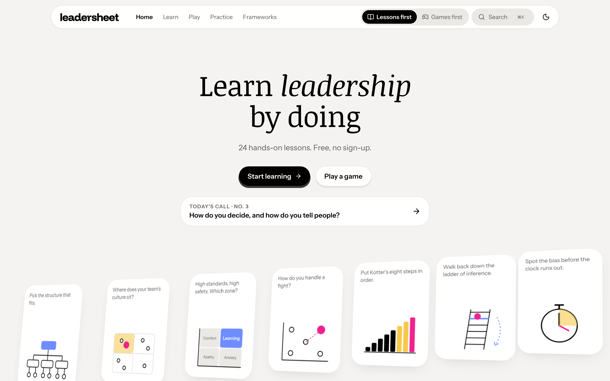
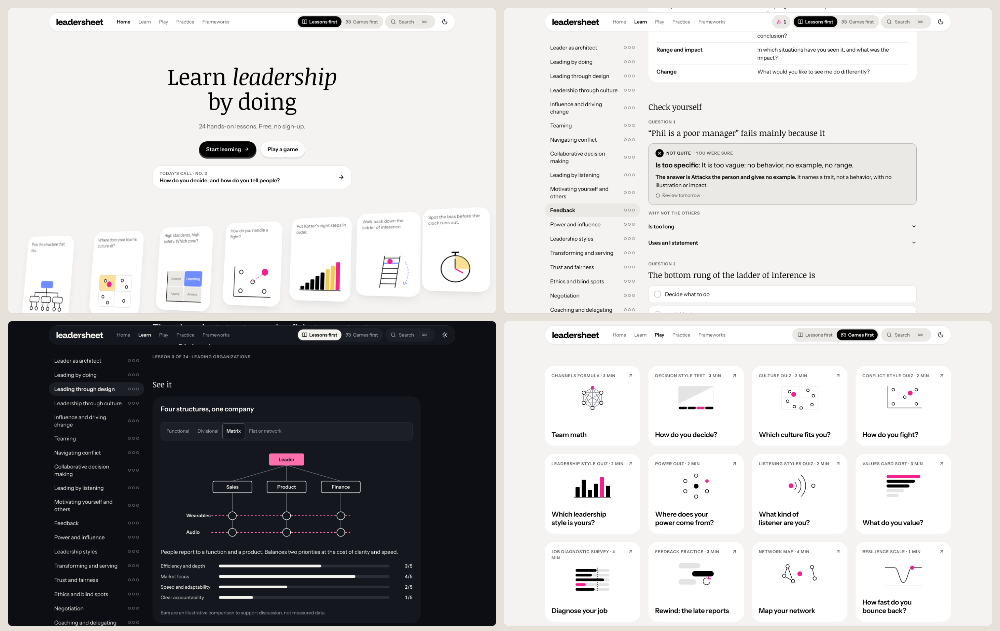
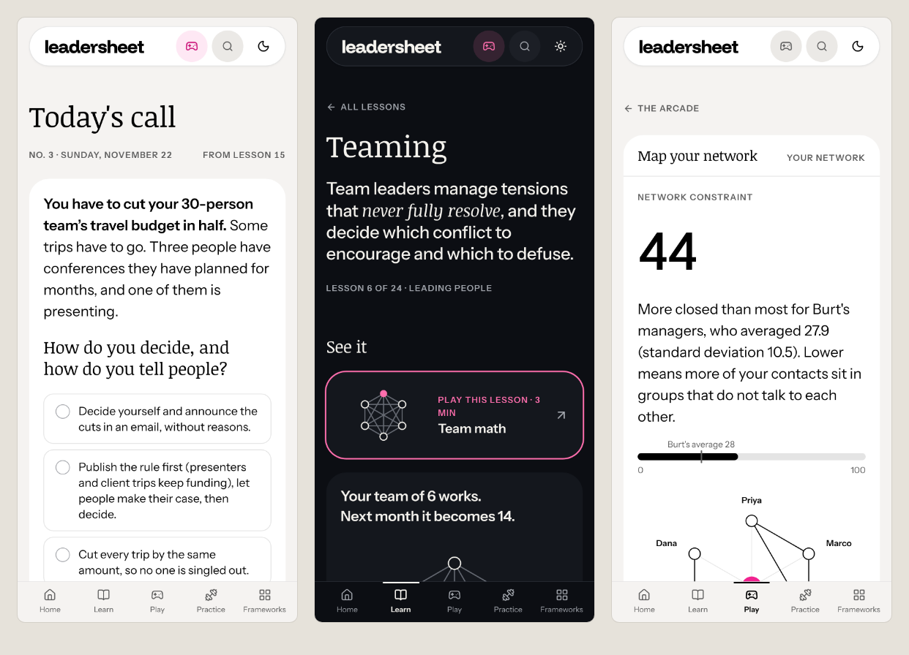

# Leadersheet

**Learn leadership by doing.** Twenty-four short lessons, each with a model you can move and a decision where your choice moves it. Free, no sign-up.

**[leadersheet.io](https://leadersheet.io)** · [How it's built](https://leadersheet.io/built/) · [Every framework](https://leadersheet.io/frameworks/)

[](https://github.com/skirberg/leadersheet/actions/workflows/ci.yml)
[](LICENSE)
[](NOTICE.md)

[](https://leadersheet.io)

Most leadership material explains a framework. Leadersheet makes you use one: drag the model, make the call, see where your choice lands, then check yourself.

## What's inside

| | |
|---|---|
| **24 lessons** in seven parts, laid out as a path | Each one: a model you can drag or tap, *Your call* (a decision case), the readings, the frameworks, a three-question check that asks how sure you are, then says why every option is right or wrong |
| **24 decision cases, 75 choices** | Graded Strong call, Trade-off or Costly, with the reason from the research. In 15 lessons your choice moves the model |
| **54 frameworks**, each with its own page | Kotter's 8 steps, Thomas-Kilmann, GROW, BATNA and ZOPA, the ladder of inference, French and Raven, Goleman's six styles and more |
| **Today's call** | One leadership decision a day, the same for everyone. Say how sure you are, then see what follows and why the other calls fall short. [Class mode](https://leadersheet.io/today/class/) runs it with a room on a projector: vote, talk, vote again |
| **14 quizzes, games and self-checks** | [Team math](https://leadersheet.io/play/team/), [How do you decide?](https://leadersheet.io/play/decide/), [culture fit](https://leadersheet.io/play/culture/), [conflict style](https://leadersheet.io/play/conflict/), [leadership style](https://leadersheet.io/play/style/), [power](https://leadersheet.io/play/power/), [listening](https://leadersheet.io/play/listen/), [values](https://leadersheet.io/play/values/), [Bias blitz](https://leadersheet.io/play/bias/), [Kotter climb](https://leadersheet.io/play/climb/), and [Rewind](https://leadersheet.io/play/rewind/), a hard feedback conversation you play line by line and can rewind. 39 results with their own pages, and a share card for every game |
| **Published self-checks, scored their way** | The [Job Diagnostic Survey](https://leadersheet.io/play/job/) (Hackman and Oldham) against its norms, the [Brief Resilience Scale](https://leadersheet.io/play/bounce/) word for word, and a [network map](https://leadersheet.io/play/network/) scored with Burt's network constraint. Names and answers stay in the browser |
| **Your sheet** | One page that fills in as you go: your calls and grades, your results, your values and what the mirror said. Send it as one image or a link, or print it |
| **Practice** | Missed questions come back 1, 3, 7 and 21 days later; a drill, a final test across all 24 lessons, framework matching, flashcards, a streak |

Every reading is cited and linked, and every number on the site was checked against its source ([docs/SOURCES.md](docs/SOURCES.md)). Summaries are for learning; read the originals.

[](https://leadersheet.io)

## What makes it different

- **Decide, don't just read.** Each lesson ends in a situation where you choose, and your choice lands on the framework, often moving the model on the page.
- **Honest grading.** Judgment calls are graded Strong call, Trade-off or Costly, with the reason. Quizzes say so when no style leads, rather than handing everyone a type.
- **Feedback that explains.** Every wrong option in every check says why it is wrong, and you say how sure you were before you see it: explained feedback and confidence are what the learning research supports ([docs/SOURCES.md](docs/SOURCES.md)).
- **Real instruments, real maths.** The self-checks use the published items and scoring keys; unit tests check the network map against Burt's own worked example.
- **Readable like Brilliant.** One type scale measured from Brilliant's problem player: a 24 px question, 20 px for what you read, grey only for labels.
- **On one grid.** Twelve columns, 24 px gutters, 1200 px at most (8 and 4 on smaller screens), laid out like base-ui.com: a section's name in the first three columns, its content from the fourth. Every block starts and ends on a column line, and QA fails a page that doesn't. Add `?grid` to any address to see the columns.
- **No door.** No account, no trial, no paywall. Progress stays in your browser.
- **Built to be shared.** Every result has a page and a 1200 x 630 card, so a link explains itself on any platform.
- **Checked like code.** Every case lands on a real framework row, every page names a share card that preview bots may fetch, and the voice never says "unlock".

## Stack

Next.js 16 static export with the React Compiler, React 19, TypeScript 7, Tailwind 4, shadcn/ui on Base UI (the primitives from the team that made Radix, Floating UI and Material UI), Motion and NumberFlow, linted by Oxlint. No server and no database. Vercel serves it with a strict Content-Security-Policy. The full list, with versions and why each is there, is on the site at [/built/](https://leadersheet.io/built/).

## Design system

One source for every colour, duration, easing, corner and the page grid: W3C design token files ([DTCG 2025.10](https://www.designtokens.org/tr/2025.10/)) in [`src/brand/presets/leadersheet/tokens/`](src/brand/presets/leadersheet/tokens/). Primitives are OKLCH, named by their lightness; a semantic layer (surface, text, action, border, accent, data, state) aliases them in four themes: light, dark, and both with more contrast for `prefers-contrast: more`. `npm run tokens` writes the CSS the site uses, typed colours for code, and [`/tokens.json`](https://leadersheet.io/tokens.json) for anyone building on the brand. CI fails if any of them drift from the source, if any of 120 text and mark pairs falls below WCAG 2.2 AA in any theme, or on lint. The reasoning behind the look is in [DESIGN.md](DESIGN.md).

## Run it

Node 22.18 or later.

```bash
npm install
npm run dev
```

## Commands

| Command | What it does |
|---|---|
| `npm run build` | Writes the finished static site to `out/` |
| `npm run check` | Everything below that a release needs: typecheck, lint, tokens, contrast, tests, cases, build, share cards, previews, voice, brand check, then QA every page at 320, 375, 768, 1024 and 1280 px in light and dark once it has loaded (crashes, sideways scroll, anything off the page grid, axe WCAG 2.1 AA; the share-card sources under `/og/` are pictures and are left out) |
| `npm run lint` | Oxlint: unused code, hook rules, Next.js and accessibility mistakes |
| `npm run tokens` | Writes `tokens.css`, `tokens.ts` and `public/tokens.json` from the DTCG token files. `npm run tokens:check` fails when they are out of date |
| `npm run smoke` | Behavior in real time on the built site, under the production headers: the hero tours, pauses, drags and steps by key; reduced motion holds still; search finds and opens; Games first swaps the hero; sliding pills let a quick tap through; Today's call shows its case before any JavaScript; a page change runs one view transition and a page load none; no page, no quiz or test result and no choice in any lesson's call is wider than a 320 px screen; no page errors. `npm run smoke -- https://leadersheet.io` checks the live site |
| `npm test` | Unit tests for the logic: quiz scoring and the lead rule, Team math's counts, the sheet's link and share text, saved values and mirror answers, the job survey and resilience scale against their scoring keys, network constraint against Burt's worked example, that every game has a share card and a line in this README, that this README's counts match the content, that every analytics event is listed in docs/PLAN.md, and that every page is on the page grid and the layout tokens add up |
| `npm run cases` | Every lesson has one decision case, every choice lands on a real framework row, every model key a choice writes is one the model reads, and every path through every Rewind conversation reaches an ending |
| `npm run previews` | Every page names a 1200 x 630 share card that is in the build and that robots.txt lets preview bots fetch |
| `npm run voice` | The built site never uses a word in the brand's `never` list, and nothing is set or typed in capitals but an acronym |
| `npm run shots` | Screenshots and contact sheets in `docs/`, the README's opening picture, and the app's install screenshots in `public/screenshots/` |
| `npm run brand <preset>` | Reskin the whole site with another preset in `src/brand/presets/` |
| `npm run brand:kit` | Draw the brand kit at [/brand/](https://leadersheet.io/brand/) from the active preset: logos, marks, app icons, banners, colours, one zip |
| `npm run brand:check` | Every icon, share card and kit file is drawn from today's sources and matches what the site serves. `-- --live https://leadersheet.io` checks the live site |
| `npm run contrast <preset>` | Every text and mark pair in every theme: WCAG 2.2 AA must pass, APCA lightness contrast shown beside it |
| `npm run domains a,b com,app,io` | Domain availability straight from the registries |

## More screens





## Where things live

- `src/data/`: all content. `course.json` (lessons, readings, frameworks, checks with a reason for every option), `cases.ts` (decision cases), `daily.ts` (Today's call), `labs.ts` (model data), `games.ts` and `results.ts` (the arcade), `rewind.ts` (Rewind's conversations), `jds.ts` and `brs.ts` (the published self-checks); `src/lib/network.ts` (network constraint) and `src/lib/review.ts` (the review schedule)
- `src/components/labs/`: the interactive models
- `src/components/learn/`: the path, the decision case, the streak, framework cards
- `src/app/frameworks/`: every framework on one page, and a page for each at `/frameworks/<id>/`
- `src/app/play/results/`: the 39 result pages; `src/app/og/`: the share card sources (every game, Today's call, class mode, the results, the lessons); `npm run og` renders them into `public/og/`
- `src/app/sheet/` and `src/components/sheet/`: Your sheet; `src/lib/sheet.ts` reads it from the store and carries it in a link
- `test/`: unit tests for scoring, seeding, share links and share text (`npm test`)
- `src/lib/search-terms.ts`: the words people search for each lesson, framework and game (titles, framework headings, game descriptions); `src/lib/seo.ts`: structured data (Course, LearningResource, DefinedTerm, breadcrumbs), `/llms.txt` and `/llms-full.txt`
- `src/brand/`: everything brand-specific, as presets. `presets/leadersheet/tokens/` is the token source; `tokens.css` and `tokens.ts` beside it are generated. How to make a new one: [docs/BRAND-KIT.md](docs/BRAND-KIT.md). `kit.ts` lists the press kit; `generated.json` records what each image was drawn from
- `scripts/`: QA, smoke, cases, previews, voice, screenshots, icons, share cards, contrast, domains. TypeScript that Node runs directly, no build step
- [DESIGN.md](DESIGN.md): the reasoning behind the identity

## Contributing

Corrections to a reading, a number or a framework are the most useful thing you can send: open an issue with the source. Code changes are welcome too; read [CONTRIBUTING.md](CONTRIBUTING.md) first. Security reports go through [SECURITY.md](SECURITY.md), never a public issue.

## License

The code is [MIT](LICENSE). The lesson content, decision cases, quiz results, the Leadersheet name, logo and share cards are not open: see [NOTICE.md](NOTICE.md). Fonts are under the SIL Open Font License.
